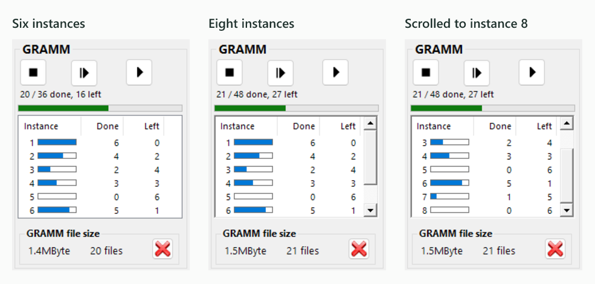

# GRAMM instance progress on Windows



The screenshots show the patched Windows GUI with sample counts. Each row counts final wind fields for its assigned original weather situations. Hover over a row to see its situation numbers. The file-size box includes intermediate sunrise wind fields too.

## Reproduce the sunrise scheduling check

Use .NET 10, the GUI source from the pull request and the [stock GRAMM source at 1cfd22d](https://github.com/GralDispersionModel/GRAMM/tree/1cfd22dfa3a26de39ee050af0e92324b9b1b96e7). Run the following in PowerShell from the directory containing this README, with the two paths set to your checkouts.

```powershell
$gui = (Resolve-Path 'C:/src/patched-GUI').Path
$gramm = (Resolve-Path 'C:/src/GRAMM').Path
$engineBin = Join-Path $env:TEMP 'gramm-scheduler-engine'
dotnet build (Join-Path $gramm 'src/GRAMM.csproj') -c Release -o $engineBin
dotnet run --project ./SchedulerChecks.csproj -c Release "-p:GuiSource=$gui" -- (Join-Path $engineBin 'GRAMM.dll')
```

The check calls the stock engine's `Meteopgtall.Integrationtime` method. For each of 7,200 small input plans it enumerates every possible contiguous partition and checks that the GUI attains the lowest maximum nominal integration time. It also checks 11 cases covering original IDs, equal weights, extra sunrise rows and the fallback for unsupported settings. The expected output is `{"status":"pass","engineCheckedPlans":7200,"targetedCases":11}`.

For one example, set the base modelling time to 1,800 seconds and use four original situations with stability classes 1, 2, 4 and 4 at 1.5 m/s. With two workers, splitting after situation 2 puts 43,200 model seconds on the longer range. Splitting after situation 1 reduces that maximum to 22,212 model seconds. Wall-clock time also depends on the solver's time steps and retries.
